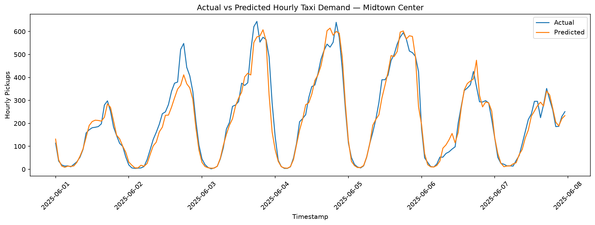
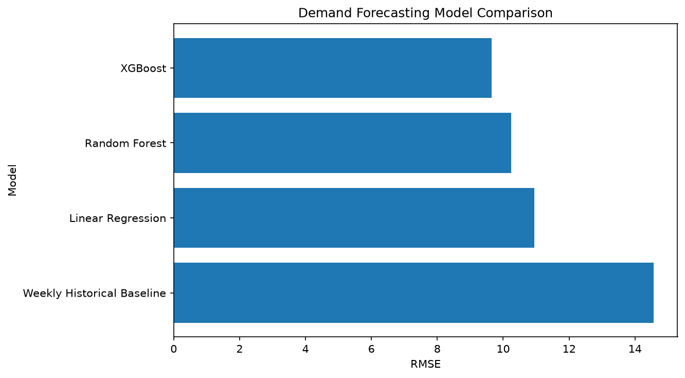
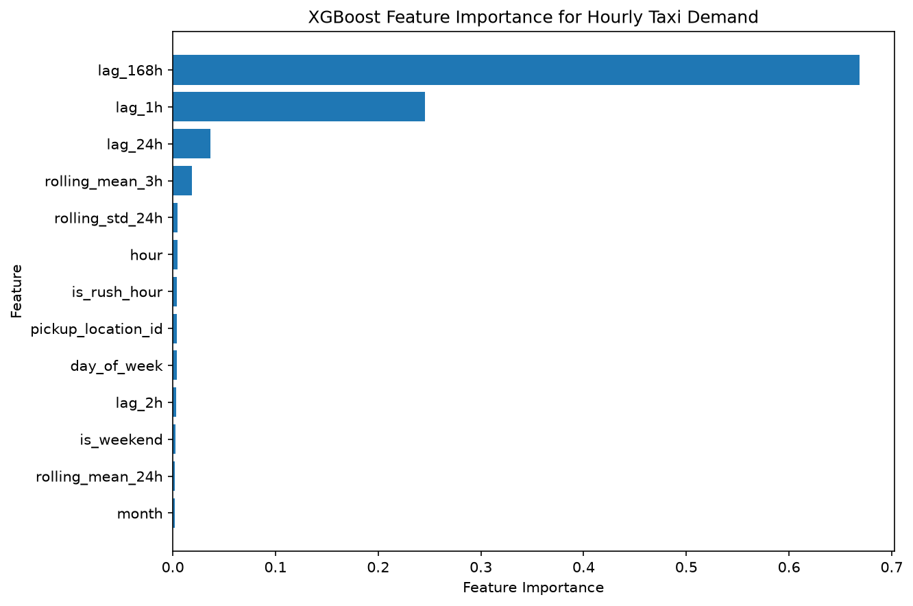

# NYC Taxi Demand & Revenue Intelligence Platform

An end-to-end data analytics and machine learning project analyzing **21.8M+ NYC Yellow Taxi trips** from January through June 2025.

The platform transforms raw NYC TLC trip records into a PostgreSQL analytics warehouse, uses SQL and Python to uncover demand and revenue patterns, and forecasts hourly taxi demand across NYC taxi zones using machine learning.

## Live Dashboard

**[View the interactive Tableau dashboard](https://public.tableau.com/app/profile/unnati.agrawal1978/viz/NYC_Taxi_Demand_Revenue_Intelligence_twbx/ExecutiveOverview)**

The Tableau workbook contains three interactive dashboards:

- **Executive Overview** — citywide demand, revenue, borough performance, hourly patterns, and rush-hour behavior
- **Demand & Geographic Intelligence** — taxi-zone demand, geographic concentration, hourly/weekday patterns, and airport performance
- **Revenue & Demand Forecasting** — actual vs. predicted demand, forecast error by zone, and model performance

---

## Project Overview

NYC taxi operations generate millions of trips every month, creating a large-scale dataset that can be used to understand transportation demand, revenue patterns, and operational efficiency.

This project answers questions such as:

- When is taxi demand highest?
- Which NYC taxi zones generate the most trips and revenue?
- How do Manhattan, Queens, Brooklyn, the Bronx, and Staten Island differ operationally?
- How do airport trips differ from typical city trips?
- Does rush-hour congestion translate into higher trip value?
- Which payment methods dominate taxi transactions?
- Can historical demand patterns predict future hourly taxi demand?

The project covers the full analytics lifecycle:

**Raw TLC Data → Python ETL → PostgreSQL → SQL Analytics → Statistical Analysis → Machine Learning → Tableau**

---

## Dataset

**Source:** NYC Taxi & Limousine Commission (TLC) Yellow Taxi Trip Records

**Period:** January–June 2025

| Stage | Records |
|---|---:|
| Raw trip records | 24,083,384 |
| Cleaned trip records | 21,853,572 |
| Final warehouse records | 21,853,439 |
| Overall retention | ~90.7% |

The raw dataset includes pickup/dropoff timestamps, taxi zones, trip distance, fare components, payment type, passenger count, airport fees, congestion surcharges, and other trip attributes.

Large raw and processed datasets are intentionally excluded from this repository.

---

## Architecture

```text
NYC TLC Parquet Files
        |
        v
Python ETL Pipeline
Extract → Clean → Validate → Engineer Features
        |
        v
PostgreSQL Analytics Warehouse
Fact Trips + Dimension Tables
        |
        +--------------------+
        |                    |
        v                    v
SQL Analytics          Python Analysis
                             |
                             v
                     Demand Forecasting
                             |
        +--------------------+
        |
        v
Tableau Public Dashboards
```

---

## Data Engineering

The ETL pipeline processes monthly NYC TLC Parquet files using Python and pandas.

### Data Quality & Transformation

The pipeline performs:

- Invalid timestamp filtering
- Source-month validation
- Trip duration calculation
- Invalid/negative fare filtering
- Distance and duration validation
- Taxi-zone enrichment
- Date/time feature engineering
- Weekend and rush-hour classification
- Average-speed calculation
- Revenue-efficiency metrics
- Airport-trip identification

Approximately **90.7% of the original 24M+ records** passed the cleaning and validation pipeline.

### PostgreSQL Warehouse

The analytical warehouse uses a star-style schema centered around:

```text
fact_trips
    |
    +-- dim_zone
    +-- dim_date
    +-- dim_payment
```

Materialized views and indexes support repeated analytical queries and Tableau reporting.

---

## Key Business Insights

### Demand

- **21.85M** validated Yellow Taxi trips were analyzed.
- The busiest pickup hour was approximately **6 PM (18:00)** with about **1.49M trips**.
- Demand falls substantially during the early-morning hours around **3–5 AM**.
- Manhattan dominates overall taxi demand.

### Revenue

Total revenue across the analyzed period was approximately:

**$614.25M**

Average revenue per trip:

**$28.11**

Average trip distance:

**3.39 miles**

### Highest-Demand Pickup Zones

| Rank | Pickup Zone | Trips |
|---:|---|---:|
| 1 | Upper East Side South | 1,003,284 |
| 2 | Midtown Center | 988,920 |
| 3 | Upper East Side North | 896,039 |
| 4 | JFK Airport | 880,200 |
| 5 | Times Sq/Theatre District | 716,239 |

The analysis highlights an important distinction between **high-demand** and **high-value** zones. Manhattan zones dominate trip volume, while airport trips generate substantially greater revenue per trip.

### Airport Performance

**JFK Airport**

- ~880K trips
- ~$72.7M revenue
- ~$82.61 average revenue per trip
- ~15.8-mile average trip distance

**LaGuardia Airport**

- ~603K trips
- ~$41.6M revenue
- ~$69.01 average revenue per trip

### Rush Hour

Rush-hour trips experienced lower average travel speeds but slightly higher average revenue per trip.

| Period | Avg Speed | Avg Revenue/Trip |
|---|---:|---:|
| Rush Hour | 9.92 mph | $28.52 |
| Non-Rush Hour | 11.64 mph | $27.95 |

---

## Machine Learning: Hourly Demand Forecasting

The forecasting task predicts **hourly trip demand by NYC taxi pickup zone**.

To avoid time-series leakage, the dataset was sorted chronologically and lag/rolling features were constructed using only historical observations.

### Features

The model includes:

- Hour of day
- Day of week
- Month
- Weekend indicator
- Rush-hour indicator
- Pickup location
- 1-hour lag
- 2-hour lag
- 24-hour lag
- 168-hour / weekly lag
- 3-hour rolling mean
- 24-hour rolling mean
- 24-hour rolling standard deviation

### Train/Test Strategy

**Training:** January–May 2025  
**Holdout Test:** June 2025

A chronological split was used instead of random train/test sampling.

### Model Performance

| Model | MAE | RMSE | R² |
|---|---:|---:|---:|
| **XGBoost** | **3.55** | **9.65** | **0.970** |
| Random Forest | 3.66 | 10.24 | 0.967 |
| Linear Regression | 3.98 | 10.95 | 0.962 |
| Weekly Historical Baseline | 4.95 | 14.56 | 0.933 |

XGBoost achieved the strongest holdout performance, reducing:

- **MAE by ~28.2%**
- **RMSE by ~33.7%**

relative to the weekly historical baseline.

### Forecast Performance



### Model Comparison



### Feature Importance



The **168-hour lag** was the strongest feature, demonstrating strong weekly seasonality in NYC taxi demand.

---

## Tableau Dashboards

The Tableau layer translates the analytical results into three interactive decision-support dashboards.

### 1. Executive Overview

Provides a high-level view of:

- Total trips
- Total revenue
- Average revenue per trip
- Average trip distance
- Monthly performance
- Borough performance
- Hourly demand
- Rush vs. non-rush demand

### 2. Demand & Geographic Intelligence

Explores:

- Taxi-zone demand
- Top pickup zones
- NYC TLC taxi-zone geography
- Weekday/hour demand patterns
- Demand vs. trip value
- Airport performance

### 3. Revenue & Demand Forecasting

Presents:

- Actual vs. predicted demand
- Forecast error by taxi zone
- Model comparison
- XGBoost MAE, RMSE, and R²

**[Explore the dashboard on Tableau Public](https://public.tableau.com/app/profile/unnati.agrawal1978/viz/NYC_Taxi_Demand_Revenue_Intelligence_twbx/ExecutiveOverview)**

---

## Repository Structure

```text
nyc-taxi-intelligence/
│
├── etl/
│   ├── extract.py
│   ├── transform.py
│   ├── load.py
│   ├── load_dimensions.py
│   └── run_pipeline.py
│
├── sql/
│   ├── schema.sql
│   ├── dimensions.sql
│   ├── indexes.sql
│   ├── analytics.sql
│   ├── views.sql
│   └── ml_dataset.sql
│
├── notebooks/
│   ├── 01_eda.ipynb
│   ├── 02_analysis.ipynb
│   └── 03_demand_forecasting.ipynb
│
├── tableau/
│   └── NYC_Taxi_Demand_Revenue_Intelligence.twb
│
├── images/
│   ├── actual_vs_predicted.png
│   ├── forecast_feature_importance.png
│   └── model_comparison.png
│
├── requirements.txt
├── .gitignore
└── README.md
```

---

## Technology Stack

**Data Engineering:** Python, pandas, NumPy, PyArrow  
**Database:** PostgreSQL, SQLAlchemy, psycopg2  
**Analytics:** SQL, pandas, SciPy  
**Machine Learning:** scikit-learn, XGBoost  
**Visualization:** Tableau Public, Matplotlib  
**Geospatial:** NYC TLC Taxi Zone Shapefile  
**Development:** Jupyter Notebook, Git, GitHub

---

## Running the Project

Clone the repository and create a virtual environment:

```bash
python -m venv .venv
source .venv/bin/activate
pip install -r requirements.txt
```

Create the PostgreSQL database:

```bash
createdb nyc_taxi
```

Create the schema:

```bash
psql nyc_taxi < sql/schema.sql
```

Run the ETL pipeline:

```bash
python etl/run_pipeline.py
```

The raw NYC TLC files are not stored in this repository because of their size. Download the Yellow Taxi Trip Record files from the NYC TLC Trip Record Data portal before running the complete pipeline.

---

## Project Highlights

This project demonstrates:

- Processing and validating **24M+ raw records**
- Designing a PostgreSQL analytical warehouse
- Building reusable Python ETL workflows
- Writing analytical SQL across millions of records
- Performing statistical and operational analysis
- Engineering leakage-safe time-series features
- Comparing baseline and machine-learning forecasting approaches
- Building interactive geographic and executive Tableau dashboards
- Communicating technical findings through business-oriented KPIs

---

## Author

**Unnati Agrawal**

M.S. Computer Science, Emory University

Data Analytics • Data Science • Machine Learning • Software Development